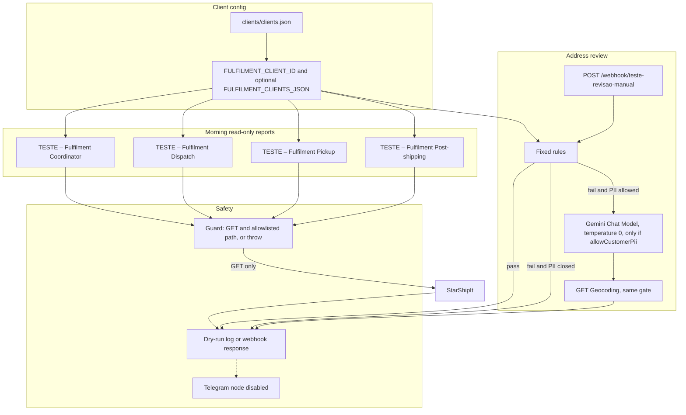

# Fulfilment agent team

Four read-only assistants for Cytron's self-hosted n8n (2.43.4), with House of Mouth (HOM) as the first client. Another client is another entry in `clients/clients.json`, or a JSON document in `FULFILMENT_CLIENTS_JSON`. The rules do not change.

The fixed rules decide. The language model only suggests an address correction after those rules fail, and only when that client has allowed customer addresses to leave the server. HOM has not. **The free Gemini tier must not receive real customer addresses.**

Nothing here writes. There is no label, no StarShipIt PUT or POST, no Shopify, Sheets, or Postgres write. Telegram nodes are disabled. Every workflow is named `TESTE – …` and has `active: false`.

This package was not imported into n8n and was not deployed. See `deploy/NOT-EXECUTED.md`.

## Architecture



The coordinator is optional. It runs the same three GETs itself. The address agent is not on the cron. If the coordinator and the three report workflows are both activated later, StarShipIt is read twice. They all ship inactive.

Definitions, including the system prompt, tools, and escalation rules, are in `definitions/`.

## Carrier rules (HOM)

These live on the client record, not in a branch per client.

| Method or address | Result |
|---|---|
| Express, including FREE Express | Australia Post Express |
| Mailbox, any weight | Australia Post Parcel Post with signature. Never Aramex or StarTrack |
| "Australia Post" in the method name | Australia Post Parcel Post with signature |
| Standard, up to 4.99 kg | Aramex |
| Standard, 5 kg to 6 kg | StarTrack. An envelope or satchel uses the Australia Post fallback |
| Standard, above 6 kg | Australia Post Parcel Post |
| Standard, above 4.99 kg and below 5 kg | No carrier. Escalation `no_carrier_band` |

Mailbox means the street, building, company, or suburb matches PO Box (including `PO Box12` and `POBox12`), Post Office Box, Post Box, GPO Box, Locked Bag, Private Bag, Parcel Locker, Parcel Collect, PO Locker, APL, PMB, or CMB.

Express to a mailbox stays on Parcel Post and is escalated. A client config that names Aramex or StarTrack as the mailbox carrier is refused.

## How to import as inactive TESTE

1. In n8n 2.43.4, open the workflow list and choose Import from file.
2. Import each file in `n8n/` on its own. Do not import over a workflow that is already in the HOM folder. These files have no workflow id, so n8n should create new ones.
3. Confirm the name starts with `TESTE –` and the workflow is **inactive**. `active` in the file is `false`. Inactive means the cron does not fire and the webhook does not listen.
4. Do not set the production error workflow on these copies. A failure must not page the live Telegram alert.
5. Do not activate them. Do not enable the Telegram nodes. The Dry-run log, or the webhook response, is the output.
6. Map credentials only in the n8n UI, after a human review:
   - StarShipIt is not a stored credential. The HTTP nodes read env var names from the client record.
   - Google Gemini Chat Model: select a credential on the address workflow. Leave HOM's `allowCustomerPii` false, or the Check LLM node throws before the model runs.
   - Google Maps: query-auth credential, only used on the same PII-allowed branch. The key is not in the file.

The address path is `teste-revisao-manual`, not the production path `revisao-manual`.

Regenerate the JSON after a rules change:

```bash
npx tsx agents/fulfilment/scripts/build-workflows.ts
```

Review `rules/engine.ts`. The JSON repeats that module so each n8n Code node can run without the repo.

## Env var names

Values stay on the server. None are in this repo.

| Name | Used for |
|---|---|
| `FULFILMENT_CLIENT_ID` | Client key. Default `hom` |
| `FULFILMENT_CLIENTS_JSON` | Optional full `{ "clients": { ... } }` document. Merged over the embedded file by client id |
| `HOM_STARSHIPIT_BASE_URL` | StarShipIt base URL for HOM |
| `HOM_STARSHIPIT_API_KEY` | StarShipIt API key header |
| `HOM_STARSHIPIT_SUBSCRIPTION_KEY` | StarShipIt subscription header |
| `HOM_TELEGRAM_BOT_TOKEN` | Unused while Telegram stays disabled |
| `HOM_TELEGRAM_CHAT_ID` | Unused while Telegram stays disabled |
| `N8N_BLOCK_ENV_ACCESS_IN_NODE` | Set `false` if Prepare cannot see `$env` |
| `N8N_ENCRYPTION_KEY` | n8n itself, on your server, when you run the plan |
| `WEBHOOK_URL` | n8n itself, so the TESTE webhook URL is right |

A new client uses its own env var names inside its client record (`ACME_STARSHIPIT_API_KEY`, and so on). The HTTP node reads `$env[$json.apiKeyEnv]`.

Gemini and Maps keys are n8n credentials, not env vars in this package.

## How to add a client

1. Copy the `hom` object in `clients/clients.json` (or in the JSON you put in `FULFILMENT_CLIENTS_JSON`).
2. Set a new `id`, display name, timezone, cron, env var names, carrier bands, mailbox patterns, and postcode ranges.
3. Set `llm.allowCustomerPii` to `false` until a paid Gemini or Vertex key with a data-processing agreement is in place. The free tier must not receive real addresses.
4. Set `telegram.sendingEnabled` to `false` until a reviewed workflow is allowed to send. The TESTE copy still forces `dryRun: true`, so the flag alone does not send.
5. Create the env vars named by that record. Set `FULFILMENT_CLIENT_ID` to the new id.

No TypeScript change is required for rules, windows, env var names, or carrier bands.

What is baked into the imported workflow, and needs an n8n edit or a rebuild rather than only an env change:

- The cron expression and the workflow timezone. HOM is `30 7 * * *` in `Australia/Brisbane`. A client on another clock should get its own inactive copy, or the schedule node and workflow timezone are edited in n8n. A mismatch is reported as `schedule_mismatch`.
- The HTTP pagination cap (HOM: 20 pages, 250 orders, 1.2 s apart).
- The connected chat-model node (Gemini 2.5 Flash, temperature 0).

`FULFILMENT_CLIENTS_JSON` replaces a client id when the same id is present, and adds an id when it is new. Send the whole client object, not a partial patch.

## Deployment plan

Not executed. The plan is `deploy/docker-compose.plan.yml`.

The fulfilment team is not a separate service. It is five inactive workflows inside n8n 2.43.4. On our own server the plan is:

1. Run n8n `2.43.4` from that compose file, beside whatever else the server already runs. The file is a single n8n service with a named volume.
2. Put the env var names above in the server environment. Do not commit the values.
3. Import the five JSON files and leave them inactive.
4. Select Gemini and Maps credentials in the UI only when a paid model path is approved.
5. Run each workflow once by hand with a non-production StarShipIt account and read the Dry-run log.
6. Only after that review, decide whether a copy without the TESTE dry-run lock should exist. That copy is not in this branch.

The compose service is on the profile `do-not-run`, so a plain `docker compose up` does not start it. This branch did not run Docker.

## Tests

```bash
npm test
npx tsc --noEmit
```

The rule tests cover the PO Box spellings (`PO Box12`, Post Box, parcel locker, APL, PMB, CMB), the HOM weight bands, and the address gaps above. The workflow tests check that every file is inactive, named `TESTE –`, GET-only on enabled HTTP nodes, guarded, free of production workflow ids, and free of credential ids.

## Known gaps

- No suburb-to-postcode table. `Southport QLD 4000` still passes.
- One-word streets such as `Broadway` still fail the street-type list. `12 Flat Rock Rd` and `8 Level Crossing Rd` pass, and they are not mailboxes.
- `Unit 5, Queen St` still passes, because any digit satisfies the street-number check.
- The unshipped lookback of 120 days is a default so the listing is not limited to ~24 hours. It is not a figure from StarShipIt's documentation in this repo. Change `windows.unshippedLookbackDays` if the account should look further back.
- `$env[$json.apiKeyEnv]` is the multi-client header. The live HOM workflows use `$env.HOM_STARSHIPIT_API_KEY` with a fixed name. If this n8n build rejects a dynamic `$env` key, set the header expression to the client's env name in the UI. That is a workflow edit, not an application change.
- Code nodes read `$env`. If `N8N_BLOCK_ENV_ACCESS_IN_NODE` is true, Prepare fails until it is false. HTTP expressions may still see `$env` when code nodes cannot.
- Box and SKU weight rules from the separate HOM weight agent are not part of these four assistants.
